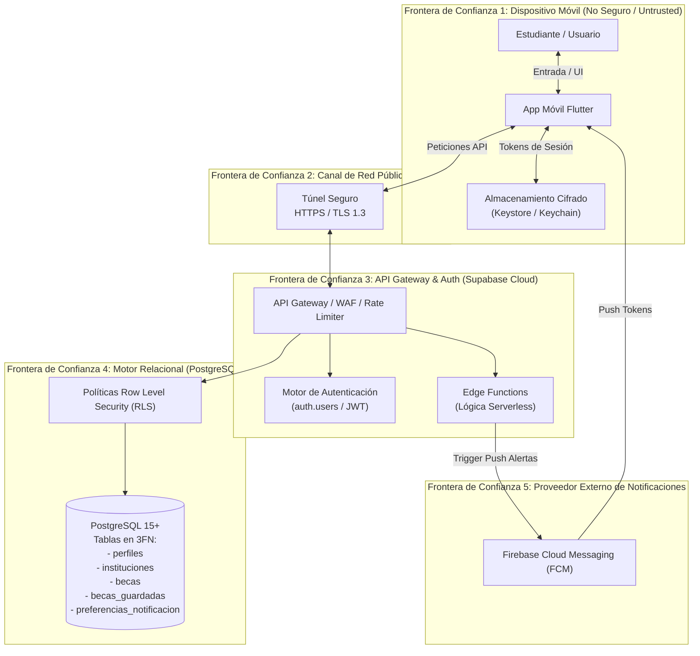
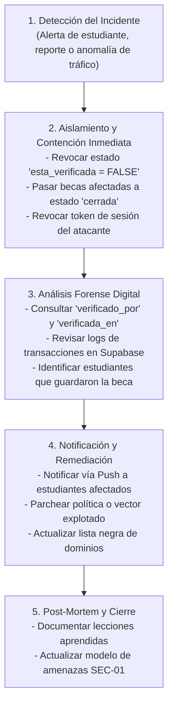

# Modelo de Amenazas y Estrategia de Mitigación (Sprint 0)
**Proyecto:** **Becify** — Plataforma Móvil Centralizada de Becas y Oportunidades Académicas  

| Metadato | Detalle |
| :--- | :--- |
| **Código de Documento** | `SEC-01-THREAT-MODEL` |
| **Nombre del Producto** | **Becify** |
| **Versión** | `1.0.0` |
| **Estado** | Aprobado — Baseline Sprint 0 |
| **Autores** | **Deurys Mercedes Batista** (Líder de Ciberseguridad, Forense Digital, Base de Datos & Backend)<br>**Diana Estephan Ferreras Feliz** (Scrum Master & Líder de Frontend Móvil Flutter) |
| **Vinculación Ágil** | Cumplimiento del **Issue #19 (`Elaborar el modelo de amenazas`)** |
| **Metodologías** | **STRIDE (Microsoft)**, **OWASP Mobile Top 10 (2024)**, **DREAD Risk Scoring** |

---

## Tabla de Contenidos
1. [Introducción y Objetivos](#1-introducción-y-objetivos)
2. [Arquitectura del Sistema y Flujo de Datos (DFD)](#2-arquitectura-del-sistema-y-flujo-de-datos-dfd)
3. [Inventario de Activos y Clasificación de Datos Sensibles](#3-inventario-de-activos-y-clasificación-de-datos-sensibles)
4. [Modelado de Amenazas STRIDE](#4-modelado-de-amenazas-stride)
5. [Mapeo de Cobertura con OWASP Mobile Top 10 (2024)](#5-mapeo-de-cobertura-con-owasp-mobile-top-10-2024)
6. [Matriz de Riesgos y Evaluación DREAD](#6-matriz-de-riesgos-y-evaluación-dread)
7. [Controles de Seguridad Implementados desde el Diseño (Security by Design)](#7-controles-de-seguridad-implementados-desde-el-diseño-security-by-design)
8. [Auditoría Forense y Procedimiento de Respuesta a Incidentes](#8-auditoría-forense-y-procedimiento-de-respuesta-a-incidentes)

---

## 1. Introducción y Objetivos

El presente documento formaliza el **Modelo de Amenazas** de la plataforma **Becify**, elaborado durante el **Sprint 0** como parte de la integración del Ciclo de Vida de Desarrollo de Software Seguro (**S-SDLC**). 

Becify maneja información de estudiantes universitarios y de secundaria, así como convocatorias académicas provenientes de instituciones oferentes. La seguridad y la confianza son pilares fundamentales: una beca fraudulenta o la filtración de datos de estudiantes comprometería severamente la misión del proyecto.

### Objetivos Principales:
1. **Identificar y categorizar** todos los activos de información, datos sensibles y componentes de la arquitectura.
2. **Modelar los vectores de ataque potenciales** utilizando la metodología **STRIDE** de Microsoft.
3. **Definir controles de mitigación preventivos** embebidos directamente en el diseño del modelo de datos relacional, la API y la aplicación móvil Flutter.
4. **Garantizar el cumplimiento estricto** de los criterios de aceptación del **Issue #19**.

---

## 2. Arquitectura del Sistema y Flujo de Datos (DFD)

El modelo de datos y la arquitectura técnica definen **cinco fronteras de confianza (*Trust Boundaries*)** a través de las cuales fluyen los datos del sistema.



### Puntos de Intercambio Críticos:
- **T1 (App ➔ API):** Transmisión de credenciales, tokens JWT y filtros de búsqueda.
- **T2 (API Gateway ➔ Motor DB):** Validación de identidad criptográfica (`auth.uid()`) contra reglas de acceso en fila (RLS).
- **T3 (Edge Function ➔ FCM):** Envío de recordatorios de vencimiento (7 días / 24 horas) con tokens de dispositivo.
- **T4 (PostgreSQL ➔ Admin):** Modificación del estado de verificación de instituciones y auditoría forense.

---

## 3. Inventario de Activos y Clasificación de Datos Sensibles

Se clasifican los activos de información del sistema en cuatro niveles de sensibilidad, analizando su estado en reposo, en tránsito y en memoria.

| ID Activo | Nombre del Activo / Dato | Clasificación | Estado en Reposo | Estado en Tránsito | Justificación del Impacto |
| :--- | :--- | :---: | :--- | :--- | :--- |
| **ACT-01** | **Tokens de Sesión (JWT / Refresh)** | **Crítico** | Cifrado en `flutter_secure_storage` (Keystore/Keychain) | TLS 1.3 | Su robo permite secuestro de cuenta (*Account Takeover*). |
| **ACT-02** | **Secretos del Servidor (`service_role_key`, FCM Admin SDK)** | **Crítico** | Secretos inyectados en CI/CD y Supabase Secrets Vault | N/A (Solo servidor) | Su compromiso otorga control total sobre la base de datos evadiendo RLS. |
| **ACT-03** | **Enlaces Oficiales de Becas (`enlace_oficial`)** | **Crítico** | Almacenado en tabla `becas` (Validado con Regex) | TLS 1.3 | Vector de ataque para **estafas financieras y phishing** dirigidos a jóvenes bachilleres. |
| **ACT-04** | **Hash de Contraseñas** | **Alto** | Argon2 / bcrypt en esquema aislado `auth.users` | TLS 1.3 | Compromiso masivo de identidades. |
| **ACT-05** | **Pistas de Auditoría Forense (`verificado_por`, `verificada_en`)** | **Alto** | Columna en tabla `instituciones` restringida a Admin | TLS 1.3 | Garantía de no repudio sobre qué administrador autorizó a un oferente. |
| **ACT-06** | **Datos Personales (PII: Nombre, Correo)** | **Medio** | Tabla `perfiles` con RLS por `auth.uid()` | TLS 1.3 | Privacidad del estudiante; cumplimiento normativo de protección de datos personales. |
| **ACT-07** | **Historial de Becas Guardadas y Postulaciones** | **Medio** | Tabla `becas_guardadas` vinculada al estudiante | TLS 1.3 | Información de interés académico y perfil socioeconómico del estudiante. |
| **ACT-08** | **Device Tokens de Notificación (FCM)** | **Medio** | Vinculado a perfil de usuario | TLS 1.3 | Posible abuso para spam de notificaciones no solicitadas. |
| **ACT-09** | **Catálogo de Convocatorias y Filtros (Público)** | **Público** | Tabla `becas` (Estado `activa`) | TLS 1.3 | Información pública de libre acceso para búsqueda. |

---

## 4. Modelado de Amenazas STRIDE

Se evalúa cada una de las seis categorías de la metodología **STRIDE** aplicada a los componentes de Becify.

```
S - Spoofing (Suplantación de identidad)
T - Tampering (Alteración o manipulación de datos)
R - Repudiation (Repudio o falta de trazabilidad)
I - Information Disclosure (Fuga de información / Exposición de datos)
D - Denial of Service (Denegación de servicio)
E - Elevation of Privilege (Elevación de privilegios)
```

### 4.1 Spoofing (Suplantación de Identidad)

| ID | Amenaza | Componente Afectado | Vector de Ataque | Control de Mitigación en Diseño |
| :--- | :--- | :--- | :--- | :--- |
| **T-S01** | Creación de institución ficticia para publicar ofertas falsas. | Módulo de Registro e Instituciones | Un ciberdelincuente se registra con rol `institucion` y publica ofertas de becas falsas para recolectar dinero o PII de estudiantes. | **Regla de Negocio RN-04:** Las instituciones nacen con `esta_verificada = FALSE`. Solo un administrador puede aprobarlas tras verificación documental fuera de banda. Las becas de entidades no verificadas no se publican en el feed. |
| **T-S02** | Secuestro de token JWT de sesión de estudiante. | Cliente Móvil Flutter | Extracción del token desde almacenamiento inseguro (`SharedPreferences` en texto plano) en dispositivos rooteados. | **Mitigación en Cliente:** Almacenamiento obligatorio en `flutter_secure_storage` (Android Keystore / iOS Keychain). Tokens JWT de vida corta (1 hora) con rotación automática. |

### 4.2 Tampering (Manipulación de Datos)

| ID | Amenaza | Componente Afectado | Vector de Ataque | Control de Mitigación en Diseño |
| :--- | :--- | :--- | :--- | :--- |
| **T-T01** | Alteración del enlace oficial de una beca hacia una URL maliciosa. | Tabla `becas` (Base de Datos) | Una institución comprometida o un atacante modifica el `enlace_oficial` para dirigir a los estudiantes a un portal de malware o phishing. | **Restricción DDL:** Validación estricta con expresión regular `chk_beca_enlace CHECK (enlace_oficial ~* '^https?://')`. Las políticas RLS restringen la modificación exclusivamente al propietario de la beca (`institucion_id = auth.uid()`). |
| **T-T02** | Modificación local de datos en SQLite / Caché local del móvil. | Caché del Dispositivo | Manipulación de la interfaz para simular becas o estados falsos. | **Arquitectura:** La app no confía en datos locales para acciones críticas; toda validación de postulación o guardado se valida contra PostgreSQL. |

### 4.3 Repudiation (Repudio)

| ID | Amenaza | Componente Afectado | Vector de Ataque | Control de Mitigación en Diseño |
| :--- | :--- | :--- | :--- | :--- |
| **T-R01** | Un administrador niega haber aprobado una institución fraudulenta. | Tabla `instituciones` | Un administrador aprueba una cuenta ilegítima y luego niega haber realizado la acción tras detectarse el fraude. | **Auditoría Forense:** La tabla `instituciones` cuenta con llaves foráneas y marcas temporales inmutables: `verificado_por UUID REFERENCES perfiles(id)` y `verificada_en TIMESTAMPTZ`. |
| **T-R02** | Una institución niega haber cerrado anticipadamente una convocatoria. | Tabla `becas` | Reclamaciones de estudiantes por becas cerradas antes del plazo anunciado. | **Trazabilidad:** Registro automático de `creado_en` y actualización de estado mediante transacciones atómicas documentadas. |

### 4.4 Information Disclosure (Fuga de Información)

| ID | Amenaza | Componente Afectado | Vector de Ataque | Control de Mitigación en Diseño |
| :--- | :--- | :--- | :--- | :--- |
| **T-I01** | Exposición masiva de perfiles y becas guardadas (BOLA / IDOR). | API PostgREST y Tablas `perfiles`, `becas_guardadas` | Un usuario altera el parámetro `perfil_id` en una petición REST para listar las becas guardadas o datos privados de otros estudiantes. | **PostgreSQL RLS:** Políticas a nivel de fila estrictas: `FOR SELECT USING (auth.uid() = id)` en `perfiles` y `USING (auth.uid() = perfil_id)` en `becas_guardadas`. El motor filtra en origen sin depender del código de frontend. |
| **T-I02** | Fuga de llaves maestras del servidor (`service_role_key`). | Repositorio GitHub y Código Fuente | Inclusión accidental de secretos en archivos `.env` o código subido al repositorio. | **Gobernanza Git:** Repositorio protegido con `.gitignore`, escaneo automatizado con **GitHub Secret Scanning** y **Dependabot**. La app móvil solo incluye `anon_key`. |
| **T-I03** | Intercepción de tráfico en redes Wi-Fi abiertas (MitM). | Canal de Comunicaciones | Sniffing de paquetes en redes públicas para capturar credenciales en tránsito. | **Cifrado en Tránsito:** Tráfico 100% forzado sobre **TLS 1.3 / HTTPS**. Rechazo de conexiones HTTP inseguras. |

### 4.5 Denial of Service (Denegación de Servicio)

| ID | Amenaza | Componente Afectado | Vector de Ataque | Control de Mitigación en Diseño |
| :--- | :--- | :--- | :--- | :--- |
| **T-D01** | Scraping agresivo o saturación de peticiones en el feed de becas. | Endpoint del Feed de Becas | Bots realizan miles de consultas por segundo buscando extraer la base de datos o saturar el CPU del motor de base de datos. | **Optimización y WAF:** Índices compuestos de base de datos (`idx_becas_feed_filtros`, `idx_becas_area_estudio`), paginación obligatoria de resultados (máximo 20-50 registros) y Rate Limiting en el Gateway de Supabase (Cloudflare / Kong). |
| **T-D02** | Inundación de notificaciones push de vencimiento (Spam). | Módulo de Notificaciones y FCM | Bucle de ejecución no controlado que envía cientos de alertas al móvil del estudiante. | **Consentimiento Granular:** Tabla `preferencias_notificacion` con banderas booleanas `notificar_7_dias` y `notificar_24_horas`. Tareas programadas (*Cron Jobs*) con validación de idempotencia para ejecutar una sola vez por periodo. |

### 4.6 Elevation of Privilege (Elevación de Privilegios)

| ID | Amenaza | Componente Afectado | Vector de Ataque | Control de Mitigación en Diseño |
| :--- | :--- | :--- | :--- | :--- |
| **T-E01** | Un estudiante modifica su rol para convertirse en `admin` o `institucion`. | Tabla `perfiles` | Petición `PATCH /perfiles` manipulando el campo `"rol": "admin"`. | **Control RBAC:** La política RLS de actualización prohíbe explícitamente modificar la columna `rol` por usuarios no administradores. Función de seguridad `es_admin()` con atributo `SECURITY DEFINER` para validar accesos administrativos. |

---

## 5. Mapeo de Cobertura con OWASP Mobile Top 10 (2024)

| Categoría OWASP Mobile (2024) | Relevancia en Becify | Estado de Mitigación en Becify |
| :--- | :--- | :---: |
| **M1: Improper Credential Usage** | Uso de llaves de Supabase y tokens JWT en la app Flutter. | **Mitigado:** Solo se compila con `anon_key` pública. Tokens de sesión en Keystore/Keychain. |
| **M2: Inadequate Supply Chain Security** | Dependencias de paquetes Dart / Flutter (`pub.dev`). | **Mitigado:** Bloqueo de versiones en `pubspec.lock` y auditoría de paquetes con Dependabot. |
| **M3: Insecure Authentication/Authorization** | Control de acceso a datos de otros estudiantes y roles. | **Mitigado:** PostgreSQL Row Level Security (RLS) y función `es_admin()`. |
| **M4: Insufficient Input/Output Validation** | Enlaces externos de becas y campos de texto libre. | **Mitigado:** Regex en BD (`chk_beca_enlace`, `chk_correo_formato`) y sanitización en cliente. |
| **M5: Insecure Communication** | Tráfico entre app y backend Supabase / FCM. | **Mitigado:** Canal 100% cifrado sobre TLS 1.3. |
| **M6: Inadequate Privacy Controls** | Almacenamiento innecesario de datos privados de estudiantes. | **Mitigado:** Principio de minimización: no se piden documentos de identidad ni notas en el MVP. |
| **M7: Insufficient Binary Protections** | Ingeniería inversa sobre el APK / IPA de Flutter. | **Mitigado:** Compilación nativa optimizada (`--release` con ofuscación y tree-shaking). |
| **M8: Security Misconfiguration** | Configuración permisiva de base de datos o almacenamiento. | **Mitigado:** Políticas RLS cerradas por defecto (*Deny by default*). |
| **M9: Insecure Data Storage** | Persistencia de credenciales en SQLite o texto plano. | **Mitigado:** Uso exclusivo de `flutter_secure_storage`. |
| **M10: Insufficient Cryptography** | Algoritmos de cifrado y generación de identificadores. | **Mitigado:** UUID v4 generados criptográficamente (`gen_random_uuid()` / `pgcrypto`). |

---

## 6. Matriz de Riesgos y Evaluación DREAD

Se califica cada amenaza identificada en una escala de 1 a 10 según el modelo **DREAD**:
- **D**amage (Daño potencial)
- **R**eproducibility (Facilidad de reproducción)
- **E**xploitability (Facilidad de explotación)
- **A**ffected Users (Usuarios afectados)
- **D**iscoverability (Facilidad de descubrimiento)

$$\text{Puntuación DREAD} = \frac{D + R + E + A + D}{5}$$

| ID Amenaza | Descripción Resumida | D | R | E | A | D | Score Promedio | Nivel de Riesgo | Prioridad de Mitigación |
| :--- | :--- | :---: | :---: | :---: | :---: | :---: | :---: | :---: | :---: |
| **T-S01** | Convocatorias de becas fraudulentas (Phishing) | 9 | 7 | 6 | 9 | 8 | **7.8** | **ALTO** | **Inmediata (Sprint 0 / MVP)** |
| **T-I01** | Fuga de datos / BOLA en perfiles y becas guardadas | 8 | 8 | 8 | 8 | 7 | **7.8** | **ALTO** | **Inmediata (Sprint 0 / MVP)** |
| **T-E01** | Elevación de privilegios a rol Administrador | 9 | 6 | 5 | 10 | 6 | **7.2** | **ALTO** | **Inmediata (Sprint 0 / MVP)** |
| **T-T01** | Manipulación de enlaces oficiales de convocatorias | 8 | 7 | 6 | 7 | 7 | **7.0** | **ALTO** | **Inmediata (Sprint 0 / MVP)** |
| **T-I02** | Fuga de secretos (`service_role_key`) en repositorio | 10 | 5 | 5 | 10 | 5 | **7.0** | **ALTO** | **Inmediata (Sprint 0 / MVP)** |
| **T-S02** | Secuestro de tokens JWT en almacenamiento móvil | 7 | 6 | 5 | 4 | 6 | **5.6** | **MEDIO** | **Planificada (Sprint 1)** |
| **T-D01** | Scraping agresivo o DoS en el Feed móvil | 5 | 8 | 7 | 6 | 8 | **6.8** | **MEDIO** | **Planificada (Sprint 1)** |
| **T-D02** | Spam de notificaciones push de vencimiento | 4 | 6 | 6 | 5 | 6 | **5.4** | **MEDIO** | **Planificada (Sprint 2)** |
| **T-R01** | Repudio de verificación de instituciones por admin | 6 | 5 | 4 | 5 | 5 | **5.0** | **MEDIO** | **Mitigada en Esquema DB** |

---

## 7. Controles de Seguridad Implementados desde el Diseño (Security by Design)

Los controles de seguridad en Becify no son parches posteriores, sino que nacen integrados en el código y la arquitectura:

### 7.1 En la Base de Datos Relacional (`/database`)
1. **Identificadores UUID v4 Criptográficos:** Eliminación de IDs secuenciales enteros (`1, 2, 3...`) para erradicar ataques de enumeración e IDOR.
2. **Restricciones de Integridad por Expresiones Regulares (`CHECK`):**
   - Validación de formato de correo: `chk_correo_formato`.
   - Validación de protocolo HTTPS/HTTP en enlaces externos: `chk_beca_enlace`.
   - Longitud mínima de nombres para evitar cadenas vacías o basura.
3. **Control RBAC y Función `es_admin()`:**
   - La función `es_admin()` está declarada con `SECURITY DEFINER` y evalúa directamente la sesión contra la tabla `perfiles`.
4. **Campos Forenses Inmutables:**
   - `verificado_por` y `verificada_en` en tabla `instituciones` vinculan formalmente la auditoría a la cuenta del administrador actuante.

### 7.2 En el Cliente Móvil Flutter (`/lib`)
1. **Almacenamiento Aislado:** Integración del plugin `flutter_secure_storage` configurado con `EncryptedSharedPreferences` en Android y `kSecAccessControl` en iOS.
2. **Ofuscación de Binarios:** Compilación de producción con bandera `--obfuscate --split-debug-info` para dificultar el análisis estático y la ingeniería inversa.
3. **Manejo de Enlaces Seguros:** Lanzamiento de enlaces externos mediante `url_launcher` forzando la apertura en el navegador del sistema operativo con sandbox independiente.

### 7.3 En la Integración Continua y Repositorio (GitHub)
1. **Secret Scanning y Dependabot:** Monitoreo automatizado en cada push contra fugas de tokens o vulnerabilidades en dependencias.
2. **Revisión Obligatoria por Pull Request:** Ningún cambio de seguridad se incorpora a `develop` o `main` sin la revisión técnica cruzada del equipo.

---

## 8. Auditoría Forense y Procedimiento de Respuesta a Incidentes

En caso de detectarse un intento de intrusión, publicación fraudulenta o compromiso de credencial, se ejecutará el siguiente procedimiento de respuesta:



---

## 9. Conclusión y Próximos Pasos

El presente modelo de amenazas garantiza que Becify mitiga desde el **Sprint 0** los riesgos más críticos inherentes a una plataforma de oportunidades académicas: el fraude a estudiantes, la fuga de datos personales y la alteración de convocatorias.

### Siguientes Pasos Vinculados:
1. **Sprint 1:** Implementación de las políticas formales de **Row Level Security (RLS)** en script SQL de migraciones (`database/03_politicas_rls.sql`).
2. **Sprint 1:** Configuración de `flutter_secure_storage` en la arquitectura de autenticación de Flutter.
3. **Sprint 2:** Configuración de tareas de notificación push con reglas de idempotencia en FCM y Supabase Edge Functions.
