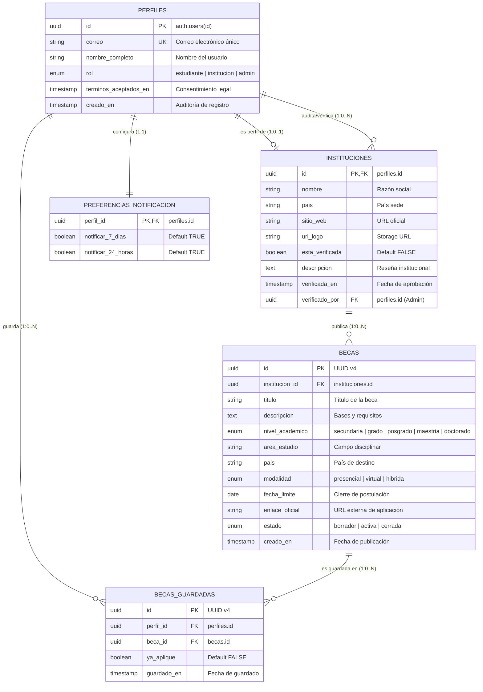

# Diseño del Modelo de Datos Relacional — Becify
**Proyecto:** **Becify** — Plataforma Móvil Centralizada de Becas  
**Documento:** `DOC-04-MODELO-DATOS-SPRINT-0`  
**Referencia:** GitHub Issue [#18](https://github.com/DianaFerrerasF/Becify/issues/18) (`Task: Diseñar el modelo de datos`)  
**Sprint:** Sprint 0 — Baseline de Ingeniería  
**Autor:** **Deurys Mercedes Batista** (Líder de Base de Datos y Ciberseguridad)  
**Metodología:** Carlos Coronel & Steven Morris (*Bases de datos: Diseño, implementación y administración*)  
**Motor de Base de Datos:** PostgreSQL 15+ / Supabase BaaS  

---

## Cumplimiento de Criterios de Aceptación (Issue #18)

| Criterio de Aceptación | Estado | Evidencia / Ubicación |
| :--- | :---: | :--- |
| **1. Diagrama Entidad-Relación** |  Cumplido | Sección 2 de este documento (DER en notación Pata de Cuervo). |
| **2. Tablas, relaciones y restricciones documentadas** |  Cumplido | Sección 3 (Normalización 3FN), Sección 4 (Diccionario) y Sección 5 (DDL). |
| **3. Guardado en `/database` y `/docs/sprint-0`** |  Cumplido | `database/01_esquema_inicial.sql`, `database/01_diccionario_datos.md` y `docs/sprint-0/02-diseno-base-de-datos-relacional.md`. |

---

## 1. Reglas de Negocio Formales (Coronel & Morris)

Conforme a la metodología canónica de Coronel & Morris (Cap. 2 y 3), se definen las reglas de integridad que rigen el modelo:

1. **RN-01 (Usuarios y Roles):** Todo usuario en `perfiles` posee un rol exclusivo (`rol_usuario_enum`: `'estudiante'`, `'institucion'`, `'admin'`).
2. **RN-02 (Aceptación Legal):** Ningún usuario puede operar en el sistema sin aceptar los términos (`terminos_aceptados_en IS NOT NULL`).
3. **RN-03 (Identificadores Criptográficos):** Todas las claves primarias utilizan `UUID v4` para mitigar ataques de enumeración forense (IDOR).
4. **RN-04 (Gobernanza Anti-Fraude):** Las instituciones se registran con `esta_verificada = FALSE`. Únicamente un administrador (`rol = 'admin'`) puede aprobarlas, registrándose la auditoría en `verificado_por` y `verificada_en`.
5. **RN-05 (Permiso de Publicación):** Solo instituciones con `esta_verificada = TRUE` pueden publicar convocatorias activas en el feed.
6. **RN-06 (Integridad Referencial 1:N):** Toda beca pertenece obligatoriamente a una institución (`institucion_id NOT NULL REFERENCES instituciones(id) ON DELETE CASCADE`).
7. **RN-07 (Coherencia Temporal):** Las convocatorias activas exigen fecha límite vigente (`fecha_limite >= CURRENT_DATE`).
8. **RN-08 (Unicidad en Guardados M:N):** Un estudiante puede guardar múltiples becas, pero no puede duplicar una misma beca (`UNIQUE(perfil_id, beca_id)`).

---

## 2. Diagrama Entidad-Relación (DER) — Notación Pata de Cuervo



---

## 3. Proceso Formal de Normalización (1FN → 2FN → 3FN)

Siguiendo el Capítulo 6 de Coronel & Morris:

1. **Primera Forma Normal (1FN):**
   * Se eliminan los grupos repetitivos multidimensionales de convocatorias y guardados.
   * Clave primaria compuesta en tabla intermedia: `{perfil_id, beca_id}`.
   * *Diagnóstico:* Se identifican **Dependencias Parciales** (atributos institucionales y de usuario dependen solo de parte de la clave compuesta), violando 2FN.
2. **Segunda Forma Normal (2FN):**
   * Se eliminan dependencias parciales particionando en tablas según su determinante completo (`BECAS_GUARDADAS`, `BECAS`, `USUARIOS_TEMP`).
   * *Diagnóstico:* En la tabla de usuarios se detecta una **Dependencia Transitiva**: `perfil_id → institucion_id` y `institucion_id → {nombre, pais, esta_verificada}`, violando 3FN.
3. **Tercera Forma Normal (3FN / BCNF):**
   * Se extrae la dependencia transitiva creando la entidad independiente `INSTITUCIONES` vinculada 1:1 con `PERFILES`.
   * **Resultado:** Cada atributo no clave depende de la clave, de toda la clave y de nada más que de la clave. Libre de anomalías de inserción, actualización y borrado.

---

## 4. Estructura de Tablas y Restricciones (DDL)

El script SQL ejecutable se encuentra en [`database/01_esquema_inicial.sql`](../../database/01_esquema_inicial.sql).

### Tipos Enumerados Oficiales:
* `rol_usuario_enum`: `'estudiante'`, `'institucion'`, `'admin'`
* `nivel_academico_enum`: `'secundaria'`, `'grado'`, `'posgrado'`, `'maestria'`, `'doctorado'`
* `modalidad_enum`: `'presencial'`, `'virtual'`, `'hibrida'`
* `estado_beca_enum`: `'borrador'`, `'activa'`, `'cerrada'`

### Función de Seguridad para RBAC:
```sql
CREATE OR REPLACE FUNCTION es_admin() 
RETURNS BOOLEAN AS $$
  SELECT EXISTS (
    SELECT 1 FROM perfiles 
    WHERE id = auth.uid() AND rol = 'admin'
  );
$$ LANGUAGE sql SECURITY DEFINER;
```

---

## 5. Diccionario de Datos

El catálogo formal completo de atributos, tipos, restricciones y dominios se encuentra en [`database/01_diccionario_datos.md`](../../database/01_diccionario_datos.md).
